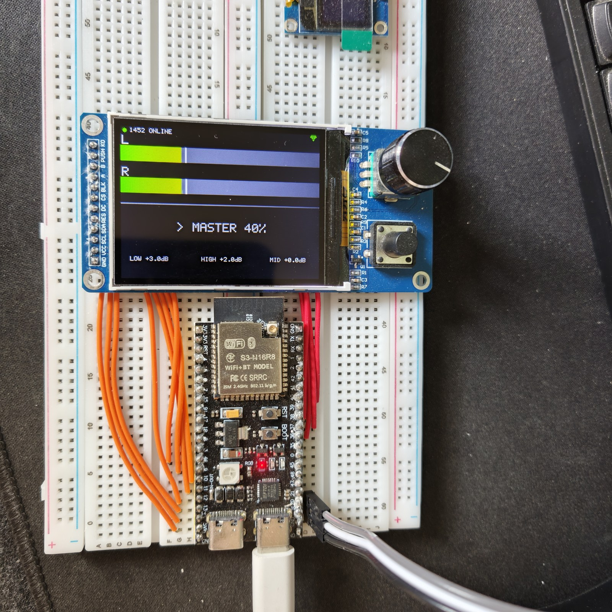
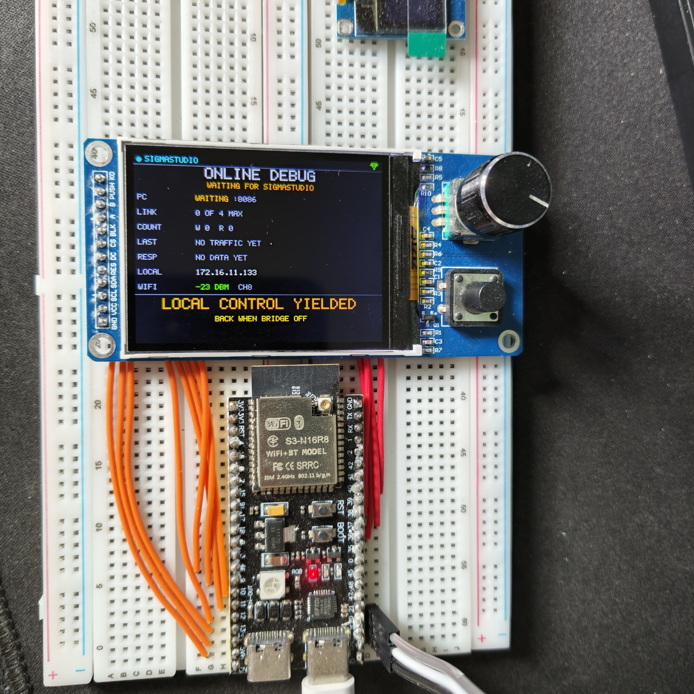
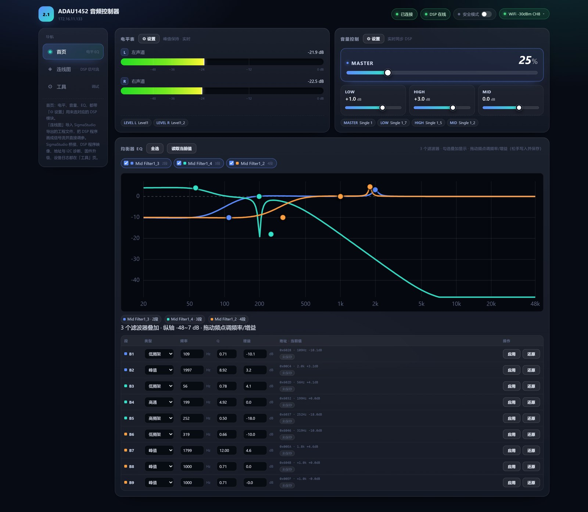
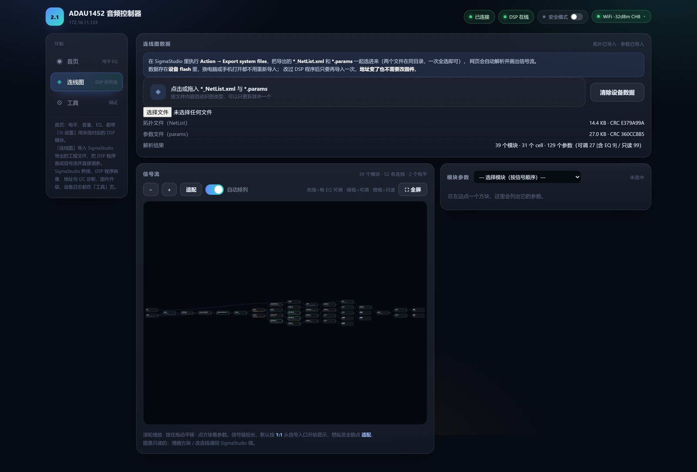
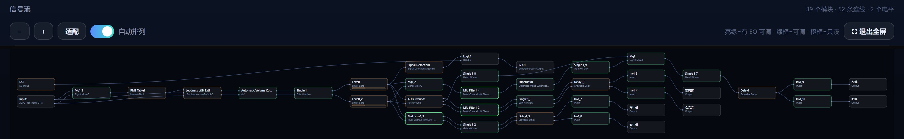
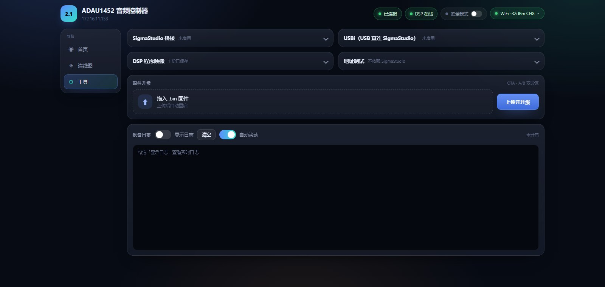

# ADAU1452 2.1 音频控制器（ESP32-S3）

> 🤖 **本项目全程由 [DeepSeek](https://www.deepseek.com/) 协助构建** —— 涵盖 ESP32 固件、
> SigmaStudio 桥接协议实现、网页控制台、Windows 桌面程序，以及本文档的全部撰写工作。
> 详见文末[「致谢」](#致谢)。

> ESP32-S3 通过 I2C 控制已烧录 SigmaStudio 工程的 ADAU1452 DSP，实现四路音量调节（总/低音/高音/中音）
> 与左右声道电平显示，配合 EC11 编码器 + ST7789 屏幕的本地交互，以及 WiFi 网页远程控制。
>
> 同时 ESP32-S3 的**原生 USB 口**还能枚举成 Analog Devices 的 **USBi**（VID `0x0456` / PID `0x7031`），
> 让 SigmaStudio 直接用 USB 线在线调参 / Link Compile Download —— 不需要 WiFi、不需要真实的 USBi 仿真器。



---

## 一、功能

| 能力 | 说明 |
|---|---|
| **本地控制** | EC11 编码器：按下切换 4 路音量，旋转加减；ST7789 屏显示电平条与 dB 值 |
| **电平显示** | 左右声道 VU 表（非线性弹道 + 峰值保持 + 颜色分级） |
| **网页控制台** | 电平实时推送、四路音量、连线图、EQ 在线调参、WiFi 配置、OTA 升级、设备日志 |
| **SigmaStudio 桥接** | ESP32 充当 TCP/IP 调试探头，等价于插 USBi，可在线调参 / Link Compile Download |
| **USBi（USB 直连）** | 原生 USB 口枚举成 ADI USBi 调试器，插一根 USB 线即可在线调参 / 下载程序（与 TCP 桥接互斥） |
| **DSP 映像** | 桥接时录制程序 → 存 flash → 1452 每次上线自动重推（脱离 EEPROM 也能起来） |
| **断电保持** | 音量与 EQ 存 NVS，上电自动写回 DSP |
| **桌面控制** | Windows 托盘程序（滚轮调总音量、展开面板、开机自启） |

---

## 二、界面展示

> 以下均为实机截图（屏幕截图取自设备自带的网页控制台）。

### 屏幕（ST7789 320×240）

| 本地控制页：电平条 + 四路音量 | SigmaStudio 桥接调试页 |
|---|---|
|  |  |

- 左：本地模式，屏幕上半为左右声道电平条（渐变 + 峰值保持线），下半显示当前音量
  （MASTER 为百分比，LOW / HIGH / MID 为 dB）。
- 右：桥接模式，本地控制让位，整屏切换为调试页，实时显示 SigmaStudio 的连接数、读写报文数、
  最近访问地址与应答耗时。

### 网页控制台

**首页** —— 左右声道电平表、四路音量（MASTER / LOW / HIGH / MID）、9 段 EQ 曲线
（参数表点「参数表」展开），改动直接写入 DSP：



**连线图** —— 导入 SigmaStudio 导出的 `*.NetList.xml` + `*.params` 后自动解析成信号流图，
可点开方块在线调参（亮绿 = 有 EQ 可调 · 绿框 = 可调 · 橙框 = 只读）：



信号流全貌（39 个模块 / 52 条连线 / 2 个电平）：



**工具** —— SigmaStudio 桥接 / USBi、DSP 程序映像（录制 / 4 槽位固件库 / 上电自动加载）、
地址调试（含 I2C 频率）、固件 OTA 升级、设备日志：



> 界面为深色极简风格：辅助说明压缩成一行提示，高级参数默认折叠，首页只保留电平/音量/EQ 三个核心区块。

---

## 三、硬件

### 开发板
- ESP32-S3，**16MB Flash + 8MB PSRAM**
- 烧录/串口：FT232 → **COM8**

### 引脚分配

| 功能 | 引脚 |
|---|---|
| ST7789 SCL（SPI 时钟） | GPIO14 |
| ST7789 SDA（SPI MOSI） | GPIO13 |
| ST7789 RES | GPIO12 |
| ST7789 DC | GPIO11 |
| ST7789 CS | GPIO10 |
| ST7789 BLK（背光 PWM） | GPIO9 |
| EC11 编码器 A / B / PUSH | GPIO35 / GPIO36 / GPIO37 |
| ADAU1452 I2C SDA | **GPIO15** |
| ADAU1452 I2C SCL | **GPIO16** |
| USBi（USB 设备）D- / D+ | **GPIO19 / GPIO20**（板载 `USB` Type-C，原生 USB，不可复用） |

> ⚠️ **GPIO19/20 是 ESP32-S3 的原生 USB D-/D+**，接板子上标 `USB` 的那个 Type-C。
> 原来的 I2C 就占着这两个脚（所以以前用不了 USB 口），现在 I2C 已挪到 **GPIO15/16**：
> 接线时 **GPIO15 → ADAU1452 SDA**、**GPIO16 → ADAU1452 SCL**，核心板 `SW2` 仍拨到 **IIC**。
> 右侧标 `UART` 的 Type-C 是 FT232（COM8），继续用于烧录和看日志；两个 USB 口可以同时插。

---

## 四、ADAU1452 DSP 接口

### I2C 通信
- 设备地址：**7 位 `0x3B`**（写 `0x76` / 读 `0x77`）
- 数据帧：**2 字节子地址（大端）+ 4 字节 32 位数据（大端）**
- 8.24 定点：`raw = round(gain × 2^24)`，`gain = 10^(dB/20)`

### 音量参数地址

| 功能 | SigmaStudio 模块 | TARGET 地址 | 默认值 |
|---|---|---|---|
| 总音量 | Single 1 | **29** | -6 dB |
| 低音 | Single 1_7 | **226** | 0 dB |
| 高音 | Single 1_5 | **164** | 0 dB |
| 中音 | Single 1_2 | **161** | +2 dB |

### 电平回读（Single Band Level Detector）

| 声道 | 模块 | X 地址 |
|---|---|---|
| 左 | Level1 | **52** |
| 右 | Level1_2 | **66** |

> ⚠️ **X 输出是 Q15，不是 8.24**：满刻度 1.0 = 32768，位于 32 位参数的低 16 位。
> `dB = 20·log10((raw & 0xFFFF) / 32768)`
> 若按 8.24（÷16777216）算，会得到 -60 dB 级别的离谱小值。

---

## 五、文件结构

```
.
├── main/                      # 固件源码（全部编译进固件）
│   ├── main.c                 # 主逻辑：编码器 / 电平读取 / NVS / 主循环调度
│   ├── ui.c/.h                # UI 层：电平页 + 桥接调试页 + 音量显示
│   ├── net.c/.h               # WiFi + HTTP + WebSocket + OTA
│   ├── web/index.html         # 网页控制台（单文件零依赖，CMake EMBED_FILES 嵌入）
│   ├── adau1452.c/.h          # DSP I2C 驱动（读写、dB↔8.24、Q15 电平换算）
│   ├── sigma_tcp.c/.h         # SigmaStudio TCP/IP 桥接服务
│   ├── usbi.c/.h              # USBi：把原生 USB 枚举成 ADI USBi，vendor 命令转发到 I2C
│   ├── idf_component.yml      # 依赖 esp_tinyusb（USB 设备栈，首次 build 自动下载）
│   ├── dsp_image.c/.h         # DSP 程序映像：录制 → flash 分区 → 上电回放
│   ├── dsp_graph.c/.h         # 连线图数据持久化（流式读写 flash）
│   ├── eq_store.c/.h          # 网页调过的 EQ 系数持久化（NVS）
│   ├── logbuf.c/.h            # 日志环形缓冲（钩 esp_log，供网页查看）
│   ├── st7789.c/.h            # ST7789 驱动（帧缓冲、局部刷新、字节序、背光 PWM）
│   ├── ec11.c/.h              # EC11 编码器（正交解码 + 按键状态机去抖）
│   ├── font5x7.h              # 5×7 点阵字库（子集，未收录字符渲染为空白）
│   └── wifi_secrets.example.h # WiFi 默认值模板 → 复制为 wifi_secrets.h 使用
├── win-volume-ctl/            # Windows 托盘音量控制器（C# WinForms）
│   ├── build.ps1              # 用系统自带 csc.exe 一键编译出单文件 exe
│   └── src/                   # 托盘图标 / 滚轮调音量 / 展开面板 / IP 设置 / 开机自启
├── usbi_host_patch/           # （可选）SigmaStudio 主机端加速：ADIUSBi.dll 兼容实现
│   ├── build.ps1              # 编译 dist/ADIUSBi.dll（csc，无需 VS）
│   ├── install.ps1            # 备份原版并替换（可一键还原）
│   ├── uninstall.ps1          # 还原原版 ADIUSBi.dll
│   └── README.md              # 原理、实测数据、风险说明
├── CMakeLists.txt             # 顶层工程定义
├── partitions.csv             # OTA 双分区表
└── sdkconfig.defaults         # esp32s3 / 16MB flash / HTTPD_WS_SUPPORT / 自定义分区表
```

> `sdkconfig` 是构建产物，**不在仓库里**（改完 `sdkconfig.defaults` 必须先删掉它再 build，否则新配置不生效）。

---

## 六、编译与烧录

ESP-IDF **v5.5.2**。工具路径按本机情况替换：

```powershell
$env:IDF_TOOLS_PATH = "d:\ESP32\ESPIDFtools"
$venvPython = "d:\ESP32\ESPIDFtools\python_env\idf5.5_py3.11_env\Scripts\python.exe"
$exp = & $venvPython "d:\ESP32\ESPIDF\v5.5.2\esp-idf\tools\activate.py" --export
. $exp
cd "C:\path\to\ECA"
idf.py -p COM8 flash        # 编译并烧录
idf.py -p COM8 monitor      # 串口监视（Ctrl+] 退出）
```

> ⚠️ 系统 Python 是 3.12，**必须用 3.11 虚拟环境加载**，且每次新开终端都要重新激活。
> 注意 `activate.py --export` 只输出一个生成的 ps1 路径，要用 `. $exp` 点源执行。

### 从仓库克隆后的第一次构建

```powershell
git clone https://github.com/MiX1024/adau1452-esp32-controller.git
cd adau1452-esp32-controller
Copy-Item main\wifi_secrets.example.h main\wifi_secrets.h   # 可选：填入自己的 WiFi
idf.py set-target esp32s3
idf.py build
```

`main/wifi_secrets.h` 是本机私密文件（已 gitignore），**不创建也能编译**：此时设备默认只开热点
`DSP-2.1`（密码 `12345678`）、不连路由器，手机连上热点后到网页「WiFi 设置」填家庭 WiFi 即可。

> 首次 build 会通过 ESP-IDF 组件管理器从 components.espressif.com 下载
> `espressif/esp_tinyusb` + `espressif/tinyusb` 到 `managed_components/`（已 gitignore），需要联网一次。
> 国内网络失败时可先设 `$env:IDF_COMPONENT_REGISTRY_URL="https://components.espressif.cn"`。

### 分区表（`partitions.csv`，16MB Flash）

| 分区 | 偏移 | 大小 | 用途 |
|---|---|---|---|
| `nvs` / `otadata` / `phy_init` | 0x9000 起 | 28KB | 配置、OTA 选择、射频校准 |
| `factory` / `ota_0` / `ota_1` | 0x10000 起 | 各 2MB | 固件（A/B 双分区 OTA） |
| `dspimg` | 0x610000 | 1MB | DSP 程序映像，4 槽 × 256KB |
| `dspgraph` | 0x710000 | 2MB | 连线图数据（NetList + params） |

> ⚠️ `dspgraph` 是**末尾追加**的，改它不影响已有偏移；再加上它**不会与** `dspimg` 重叠。

---

## 七、使用

### 设备端
- **旋转**编码器在当前选中音量上加减；**按下**在 总音量 / 低音 / 高音 / 中音 之间切换。
- 屏幕上半为左右声道电平条，下半显示当前音量（MASTER 为百分比，三音调为 dB）。
- 分辨率 320×240；能量条 `frac = 10^(db/60)`（-18 dB 落在条中央），颜色 绿→黄→橙→红。

### 网页控制台
- 设备自建热点 **`DSP-2.1`**（密码 `12345678`），连上后访问 **`http://192.168.4.1`**；
  也可让设备接入家庭 WiFi 后走局域网 IP。
- **单文件、零外部依赖**（不引用任何 CDN / 外部字体 / 图片），全部 CSS/JS 内联打包进固件。
- 左侧导航分三页：

| 页 | 内容 |
|---|---|
| **首页** | 电平表、四路音量控制 |
| **连线图** | 导入 SigmaStudio 导出文件 → 信号流图 + 在方块上直接调参 |
| **工具** | 桥接开关、**USBi（USB）开关**、DSP 程序映像、地址调试、I2C 频率、固件升级、设备日志 |

- **WiFi 设置**：分别修改设备热点（AP）与接入的路由器（STA），保存进 NVS 后自动重启生效。
- **OTA 升级**：上传 `.bin`，写入备用分区后重启（A/B 双分区，失败可回滚）。

### Windows 桌面控制程序
见 [`win-volume-ctl/README.md`](win-volume-ctl/README.md)。悬停托盘图标滚滚轮调总音量，单击展开
L/R 电平表 + 4 路滑块 + WiFi 信息。编译：`powershell -ExecutionPolicy Bypass -File build.ps1`。

> 它刻意**只用 HTTP、不碰 WebSocket**（网页的 `/ws` 是单客户端槽位），因此**可与网页同时开着**。

---

## 八、主要接口

### WebSocket `/ws`
状态 JSON 推送（约 100ms 一帧）+ 命令 `{"cmd":"set","idx":N,"value":V}`
（idx `0..3` = MASTER/LOW/HIGH/MID；MASTER 传百分比，其余传 dB）。

### HTTP（节选）

| 接口 | 说明 |
|---|---|
| `GET/POST /api/bridge` | 桥接配置：`enabled` / `port` / `local_control` / `resp_gap_us` / `verbose` |
| `GET/POST /api/usbi` | USBi（USB 直连）开关与状态：`enabled` + USB 枚举/驱动/转发统计（与桥接互斥） |
| `GET/POST /api/dspimg` | 映像状态与动作：`record_start`/`record_stop`/`save`/`replay`/`clear`/`erase_slot`/`set_boot`/`set_settle` 等 |
| `GET /api/state` | 完整状态 JSON |
| `GET/POST /api/vol` | 桌面程序专用的轻量接口（`/api/state` 的子集，供高频轮询） |
| `GET /api/dsp?addr=&len=` | 直接读 DSP 地址（`< 0xF000` 按字寻址），只读 |
| `POST /api/dsp` | 写 DSP 地址 / 软复位。**桥接开启时一律 500 拒绝** |
| `GET/POST /api/graph/netlist`、`/api/graph/params` | 连线图原文的流式上传/下载（单文件上限 512KB） |
| `GET/POST /api/i2c` | 读/改 SCL 频率与内部上拉。**桥接开启时写入被拒** |
| `GET/POST /api/bind` | 首页 6 个控件（4 音量 + 2 电平）的地址绑定 |
| `GET/POST /api/eq` | EQ 段的 `put`/`del`/`apply`/`clear`（`put` 会保存并写 DSP） |
| `GET/POST /api/safe` | 安全模式开关（开启后上电不写 DSP，防写旧地址爆音） |
| `GET/POST /api/wifi` | 读/写 WiFi 配置 |
| `GET /api/log`、`POST /api/log` | 取日志快照 / 清空 |
| `POST /ota` | 固件升级 |

---

## 九、关键实现约束（改动前必读）

这些都是实测踩过的坑，**改之前先看这一节**：

- ⚠️⚠️ **桥接应答之间必须留间隔**（默认 `30ms`，配置项 `resp_gap_us`）。
  SigmaStudio 会把多条请求合并进一个 TCP 段，若我们的多条应答在它处理一条的周期内连发，
  它一次 `recv` 全收走 → 解析错位 → **直接崩溃**。实测 2ms/5ms 会崩，15ms 起稳定，30ms 为默认。
  必须用 `esp_rom_delay_us()` 而非 `vTaskDelay()`（tick 是 10ms，精度太粗）。
- ⚠️ **电平是 Q15 不是 8.24**（见第四节）。
- ⚠️ **SPI 单次 DMA 上限 `1<<18 = 32768` 字节**，分块必须 ≤ 32KB，否则报
  `txdata transfer > hardware max supported len`。
- ⚠️ **ST7789 用 `0x20 INVOFF`**（误用 `0x21 INVON` 会导致黑底变白、绿色变品红），
  且写帧缓冲前**必须 `swap16`**（ESP32 小端），否则绿色→品红、红色→蓝。
- ⚠️ **`httpd` 的 `lru_purge_enable` 必须为 `true`**，否则连接池满时新请求无法处理
  （表现为浏览器"连不上"，而 `curl` 正常）。
- ⚠️ **PROGRAM 区写入必须 4 字节一次 + 约 300µs 间隔**，否则 I2C 收到 ACK 但指令没进 DSP。
- ⚠️ **回放的寄存器顺序不能乱**：必须照官方 `default_download_IC_1()` 的次序，否则 1452 会
  **完全不出声，但 I2C 一切正常、内存校验也通过**（PLL 一直锁着，很难查）。
- ⚠️ **1452 的 SELFBOOT 引脚接低后**，断电重启 RAM 全空，参数读到的是未初始化垃圾值，
  必须靠 ESP32 推送才能起来（这也是自动重推存在的意义）。
- ⚠️ **换 DSP 程序后地址会全部失效**：网页控件绑定与 EQ 都按 `cell|parameter` 名字自动重解析地址。
- ⚠️ 桥接开启期间，所有会写 DSP 的接口都会被拒绝（防止绕过滑块），只有读接口不受限。
- ⚠️ WiFi 默认值存在 `main/wifi_secrets.h`（不入库）；`net.c` 用 `__has_include` 读取，
  文件不存在时回退到内置通用值。
- ⚠️ **USB 与串口不能同时用同一个口**：ESP32-S3 的 USB-Serial-JTAG 和 USB-OTG 共用
  GPIO19/20 与 USB PHY，`sdkconfig.defaults` 已关闭 USJ（`CONFIG_USJ_ENABLE_USB_SERIAL_JTAG=n`）。
  所以板子标 `USB` 的口只做 USBi，不再提供 USB 串口/下载；烧录与日志继续走 `UART` 口（COM8）。
- ✅ **不开 USBi 时 USB 口在电脑上完全不可见**：ESP32-S3 的 USB-Serial-JTAG 复位默认带 D+ 上拉，
  而 CPU 软复位（`idf.py flash` / RTS 复位）时 IDF 会保留 USJ 不关，电脑就会报
  “未知 USB 设备（设备描述符请求失败）”。`usbi_init()` 启动时会显式关掉 USJ 的
  PHY 焊盘和 D+/D- 上拉（顺带关时钟），所以不启用 USBi 时插 USB 线不会有任何设备出现；
  打开 USBi 后 TinyUSB 再接管共用 PHY。
- ⚠️ **GPIO19/20 只能给 USB**：I2C 必须留在 GPIO15/16。把 I2C 接回 19/20 会直接干扰 USB
  数据线（上下拉/跳变），表现为设备枚举失败或时好时坏。
- ⚠️ **USBi 与 TCP 桥接互斥**：都独占 DSP。网页开一个会自动关另一个；NVS 里若两个都开着，
  启动时以 USBi 为准（`main.c` 里有兜底）。
- ⚠️ **USBi 模式必须让位**：开启期间本地编码器/网页音量/电平、以及「上电自动推 DSP 程序」
  全部暂停（与 TCP 桥接同一套语义），否则会把 SigmaStudio 正在下载的程序写坏。
- ⚠️ **USBi 依赖 SigmaStudio 装的 CYUSB 驱动**（`D:\APPS\SigmaStudio 4.7\USB drivers\x64\CyUSB.inf`，
  驱动版本 3.4.2.147）。设备管理器里应显示 "Analog Devices USBi (programmed)"；
  同一时间不要把真实 USBi 仿真器也插上（同 VID/PID 会让 SigmaStudio 分不清）。
- ⚠️ **TinyUSB 是组件管理器依赖**：`main/idf_component.yml` 声明 `espressif/esp_tinyusb`，
  首次 build 会下载到 `managed_components/`（已 gitignore）。国内网络下载失败时可设
  `$env:IDF_COMPONENT_REGISTRY_URL="https://components.espressif.cn"` 再 build。
- ⚠️ **USBi 控制传输超时是 1 秒**（ADIUSBi.dll 里 `ControlEndPt.TimeOut=1000`），
  所以每次 `0xB2` 写入的 I2C 处理必须够快：固件对 USBi 写入走大块快路径
  （PROGRAM 区每 248 字节一次 + 300µs settle），4KB 程序块在 400kHz 下约 100ms，
  即使主机端用 4096 字节打包也远低于超时。

---

## 十、验证状态

- ✅ ST7789 显示（颜色、方向、背光）、EC11 旋转方向与按键单次触发
- ✅ ADAU1452 I2C 通信（启动读回总音量 `0x00804DCE` ≈ -6dB，与默认值吻合）
- ✅ 电平数值合理（正常音乐 -9~-22 dB）、能量条平滑、局部刷新流畅
- ✅ NVS 断电保存 / 上电恢复音量
- ✅ WiFi 网页控制台 + OTA
- ✅ SigmaStudio TCP/IP 桥接长时间不崩溃（`resp_gap_us` 默认 30ms 是关键）
- ✅ DSP 映像录制 / 4 槽位命名固件库 / 导出 / 单独加载；**1452 每次上线自动重推** + 推送后内存校验
- ✅ 网页「连线图」：33 模块 / 41 连线，两种布局 0 重叠；在线改参 -24 dB 写入后回读一致
- ✅ EQ 在线可改并持久化，1452 重启 / 映像重推后自动写回
- ✅ 安全模式：开启后上电不写 DSP，音量/EQ 只读回
- ✅ USBi（USB 直连）：Windows 枚举为 "Analog Devices USBi (programmed)"、CYUSB 驱动自动加载；
  通过 CyUSB 控制传输读 DSP 参数（实测总音量读到 -24.30 dB，与 NVS 一致）、PLL_LOCK=1、
  写回成功、64 字节整块读成功；设备端统计 errors=0，单条命令 0.5–2ms
- ✅ 主程序编译 **0 警告**，固件约 1.19MB（2MB 分区余量 43%）

> ⚠️ 仍建议实测确认：**1452 断电冷启动 + 「就绪等待」设为 0/500ms** 时是否一次成功。
> 若日志出现「推送失败 → 改成等 1000ms 再试」才成功，就把网页上的值固定为 1500ms。

---

## 十一、USBi（USB 直连 SigmaStudio）

> 2026-10 新增：ESP32-S3 的原生 USB 口可以**完全替代**真实的 USBi 仿真器
> （EVAL-ADUSB2EBZ / 板子上那根 10pin 排线的调试器）。

### 原理

SigmaStudio 4.7 通过 `ADIUSBi.dll` + `CyUSB.sys` 与 USBi 通信；USBi 对 PC 只是一个
**vendor 自定义类、只用控制端点（EP0）**的 USB 设备：

| 请求（bRequest） | 方向 | 含义 |
|---|---|---|
| `0xB2` | OUT | 写 DSP：数据段 = `[addrH addrL payload...]` |
| `0xB3` | OUT | 取读地址：数据段 = `[addrH addrL]` |
| `0xB4` | IN | 读 DSP：返回 payload |
| `0xB5` | IN | 写完成查询（1 字节状态，1=成功） |
| `0xB6` | IN | 读完成查询（1 字节状态，1=成功） |
| `0xB7`–`0xBA` | OUT | 复位 / 目标板 5V / LED / 复位翻转（一律 ACK） |

`wValue = chipAddress >> 1`（I2C 7 位地址，本机固定 `0x3B`），
`wIndex = (clatch << 8) | format`（format：`0=I2C`、`1=SPI`）。
数据段里的 2 字节地址语义与 TCP 桥接完全一样（`<0xF000` 按字寻址），
所以 `usbi.c` 直接复用 `adau1452_write_block()/read_block()`，并且同样会调用
`dsp_image_record()` —— 用 USB 调 SigmaStudio 时，网页上的「开始录制」照样能用。

ESP32 侧用 TinyUSB 注册一个只有控制端点的 vendor 设备（`0x0456:0x7031`，
全速、EP0=64、`bDeviceClass=0xFF`），并给 vendor 请求提供 `tud_vendor_control_xfer_cb()`；
另外用 `usbd_app_driver_get_cb()` 注册一个只"认领接口"的最小类驱动
（TinyUSB 的 SET_CONFIGURATION 要求每个接口都有驱动，否则 Windows 会一直等不到配置完成）。

### 使用

1. 网页「工具」页 → **USBi（USB 直连 SigmaStudio）** → 打开「启用 USBi」。
2. 用 USB-C 数据线把电脑接到板子上标 **`USB`** 的 Type-C 口（和 COM8 那个 `UART` 口是两个口，可同时插）。
3. Windows 设备管理器出现 **Analog Devices USBi (programmed)**，驱动就是 SigmaStudio 安装的
   CYUSB 3.4.2.147，无需另装。
4. SigmaStudio 4.7：**Hardware Configuration** 里拖入 **USBi** → 应能检测到设备（USB 标签变橙色）
   → 把它连到 ADAU1452 → 通信模式选 **I2C** → 之后即可 **Link Compile Download** / 在线调参。
5. 用完在网页关掉开关：USB 设备从电脑消失，本地编码器/音量/电平恢复。

> ⚠️ 测试时拔掉真实的 USBi 仿真器：同 VID/PID 的两个设备会让 SigmaStudio 分不清。
> ⚠️ 模式互斥：USBi 与「SigmaStudio 桥接」都独占 DSP，开一个会自动关另一个；
>    本地控制与「上电自动推 DSP 程序」在 USBi 开启期间一并让位。

### 验证状态（2026-10-17，本机实测）

- Windows 枚举为 `Analog Devices USBi (programmed)`，CYUSB 驱动自动加载，ProblemCode=0
- 用 CyUSB 直接发 vendor 请求读 DSP：`0x007A`（总音量）读到 `0x000F9AA9` = **-24.30 dB**
  （与设备 NVS 值一致）；`0xF004`（PLL_LOCK）读到 `0x0001`
- 写回同一值成功（写完成查询返回 1）；64 字节整块读成功（验证 EP0 多包 IN）
- 设备端统计 `pkt_write/pkt_read/errors=0`，单条命令耗时约 0.5–2 ms

### 性能：为什么比 CY7C68013A（FX2）慢，能优化到什么程度

主瓶颈**不是 I2C，而是 ESP32-S3 的 USB 只有全速（12 Mbps）**：

| 项目 | 实测 |
|---|---|
| ESP32-S3 USBi：一次控制传输（数据量 0/1/8/64 字节都一样） | **~4.0 ms**（≈4 个 1ms 帧） |
| 一次 4 字节读（0xB3+0xB5+0xB4+0xB6，4 次传输） | 16.2 ms |
| 一次 4 字节写（0xB2+0xB5，2 次传输） | 8.1 ms |
| 其中真正的 I2C 事务（4 字节读，400kHz） | 仅 0.3~0.6 ms |

FX2 是 USB 2.0 高速（480Mbps），一次控制传输约 0.5ms，所以同样的 I2C 下它"感觉快 8 倍"——
**这是 USB 速度的差距，不是 ESP32 的 I2C 差**。ESP32-S3 硬件只有全速 USB，这一点无法用固件改变。

在这个前提下已经做的优化：

1. **固件：USBi 写入快路径**（`usbi.c`）
   - 原 `adau1452_write_block()` 是给整片冷启动回放设计的：PROGRAM 区 4 字节一次 + 300µs 间隔，
     一条 60 字节的 USBi 写命令要拆成 15 次 I2C 事务（13.6ms）
   - 现在改成一条命令一次大块 I2C 写（每块最多 248 字节）+ 一次 settle：
     **13.6ms → 2.0ms（400kHz）/ 1.26ms（1MHz）**，回读校验一致
   - 读取也支持大块（240 字节/次），大读时减少固定开销
   - USB 任务优先级提到 24（高于 WiFi 的 23），减少 I2C 完成后的唤醒延迟
   - 估算：18.9KB 程序下载从 **~5.0s → ~2.9s**

2. **可选：主机端加速 DLL**（[`usbi_host_patch/`](usbi_host_patch/)，实验性、可一键还原）
   - SigmaStudio 原版 `ADIUSBi.dll` 每次传输限 64 字节、且每次读/写后都多发 0xB5/0xB6 状态轮询
   - 本项目的固件是同步完成的，这两件事都可以省掉：
     传输块提到 4096 字节 + 跳过状态轮询
   - 实测：4 字节读 **16.2→8.0ms**、4 字节写 **8.1→4.0ms**、
     18.9KB 程序下载估算 **~5.0s→~0.9s**（详见该目录 README）
   - ⚠️ 会替换 SigmaStudio 安装目录里的 `ADIUSBi.dll`（自动备份 `.orig`，`uninstall.ps1` 还原），
     仅对本项目 ESP32-S3 USBi 有效；接真实 USBi 仿真器前请还原

3. **I2C 时钟可调**：网页「地址调试」里可把 SCL 设为 600kHz / 1MHz（本项目实测 0 错误），
   对下载速度有额外帮助；但 ADAU1452 官方上限是 400kHz，超频属越规操作。

---

## 十二、仓库说明与许可

### 哪些内容没有进仓库

| 路径 | 情况 |
|---|---|
| `main/wifi_secrets.h` | **不入库**（含真实 WiFi 凭据）；模板见 `main/wifi_secrets.example.h` |
| `build/`、`sdkconfig` | 构建产物，约 150MB+，可由源码重建 |
| `win-volume-ctl/dist/*.exe`、`*.log` | 编译产物，用 `build.ps1` 自行生成 |
| `dsp_project/`、`tools/`、`docs/` | SigmaStudio 导出文件、PC 侧调试脚本与排查存档，**不随仓库发布** |
| `photo/*.jpg` | README 展示用图；网页截图为**实机截图**，画面中带设备自身的局域网 IP |

> 关于 `dsp_project/`：其中的 `*.xml`、`*_IC_1*.h` 由 **Analog Devices SigmaStudio 生成**，
> 文件头带 ADI 版权声明（*"may not be distributed whole or in any part to third parties"*），
> 因此本仓库不包含这些文件。需要时请用你自己的 SigmaStudio 工程重新导出。

### 许可

本项目基于 **MIT License** 开源 —— 可自由使用、修改、分发与商用，只需保留版权声明。

> **Copyright (c) 2026 MiX1024** · 完整条款见 [`LICENSE`](LICENSE)

> ⚠️ 仓库中**不包含** Analog Devices SigmaStudio 生成的文件（见上一节），
> 因此本许可证仅覆盖 `main/`、`win-volume-ctl/` 及仓库内自行编写的全部内容。

---

## 致谢

本项目的**全部代码与文档均在 [DeepSeek](https://www.deepseek.com/) 的协助下完成**，包括但不限于：

- ESP32-S3 固件：ADAU1452 I2C 驱动、ST7789 显示驱动、EC11 编码器、NVS 持久化与上电时序
- SigmaStudio TCP/IP 桥接协议的解析与实现（含「应答必须留间隔」等关键时序的定位）
- 网页控制台（单文件、零外部依赖的 HTML/CSS/JS）
- Windows 托盘音量控制程序（C# WinForms）
- 本文档及仓库内全部说明文字

同时参考了以下开源实现与官方资料，在此一并致谢：

| 来源 | 用途 |
|---|---|
| [aventuri/sigma_tcp](https://github.com/aventuri/sigma_tcp) | TCP/IP 桥接协议蓝本 |
| [Kezii/rp2040-Analog-Devices-USBi](https://github.com/Kezii/rp2040-Analog-Devices-USBi) | RP2040 上的 USBi 重实现，本项目 USBi 部分的行为参考 |
| Analog Devices 官方 `sigma-tcp`（`dev-extended-mode`）与 AD wiki *TCP/IP Channels* | 14 字节报文头定义 |
| [Wei1234c/TCPi](https://github.com/Wei1234c/TCPi) | ESP32 作服务端 + 读回 |
| [mzulus/ESP32_ADAU1452_RAM_Loader](https://github.com/mzulus/ESP32_ADAU1452_RAM_Loader) | 地址语义与 PROGRAM 写入时序 |

> 本仓库为独立实现，未包含上述项目的代码；它们仅作为协议与行为的参考资料。
